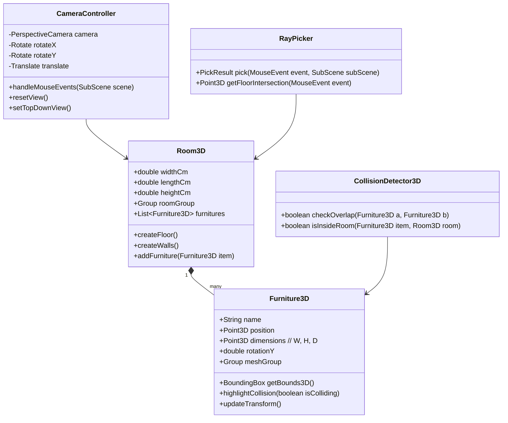

# 🏠 Java 기반 3D 룸 플래너 (3D Furniture Planner) 설계 및 개발 계획서

## 1. 프로젝트 개요
사용자가 방의 치수를 설정하고, 3D 가상 공간에서 가구를 마우스로 직관적으로 배치·회전·높이 조절할 수 있는 **Java 기반 3D 인테리어 시뮬레이션 데스크톱 프로그램**입니다.

---

## 2. 3D 기술 스택 선정 및 비교

Java에서 3D GUI 프로그램을 제작할 때 가장 적합한 방식을 비교·선정했습니다.

| 비교 항목 | **방안 1: JavaFX 3D (강력 권장)** ⭐ | 방안 2: jMonkeyEngine (jME3) |
| :--- | :--- | :--- |
| **개요** | JavaFX 내장 3D API (`SubScene`, `PerspectiveCamera`, `MeshView`) | Java 전문 3D 게임/시뮬레이션 엔진 |
| **장점** | • 추가 무거운 엔진 없이 순수 Java로 구동<br>• 좌측 가구 목록, 우측 속성 패널 등 **일반 2D UI와 3D 뷰포트의 자연스러운 결합**<br>• 가볍고 빌드/배포가 매우 단순함 | • 고품질 셰이더, 사실적 그림자, PBR 텍스처<br>• 복잡한 대형 3D 모델 처리 성능 우수 |
| **단점** | • 실시간 복잡한 하드웨어 그림자는 자체 구현 필요 | • 일반 데스크톱 UI(메뉴, 입력폼) 구현이 상대적으로 번거로움 |
| **결론** | **인테리어/가구 배치 프로그램의 UI 편의성과 빠른 개발에 최적화** | 게임 수준의 그래픽 퀄리티가 최우선일 때 선택 |

> 👉 **권장 기술 스택**: **Java 21 + JavaFX 21 (3D SubScene) + Gradle**  
> (필요 시 추후 3D OBJ 모델 로더 라이브러리 `FXyz3D` 또는 커스텀 OBJ 로더 연동)

---

## 3. 3D 핵심 기능 요구사항

### 3.1. 3D 뷰포트 및 카메라 컨트롤 (Camera Control)
- **마우스 궤도 카메라 (Orbit Camera)**:
  - **회전 (Orbit / Tumble)**: 마우스 우클릭(또는 좌클릭) 드래그로 방 주위를 360도 자유 회전 (Azimuth, Elevation).
  - **줌 (Zoom)**: 마우스 휠 스크롤로 확대/축소.
  - **패닝 (Pan)**: 마우스 휠 클릭(또는 Shift + 드래그)으로 시점 이동.
- **뷰 프리셋 (View Presets)**:
  - 투시 뷰 (Perspective 3D)
  - 탑뷰 평면도 (Top-Down Orthographic)
  - 1인칭 방 내부 걷기 뷰 (First-Person Walkthrough, 추후 확장)

### 3.2. 3D 공간 및 건축 요소 (3D Room Construction)
- **3D 바닥 (Floor)**:
  - 가로 x 세로 치수(예: 400cm x 500cm) 기반 바닥 매쉬 생성.
  - 격자(3D Grid) 가이드라인 렌더링 (10cm / 50cm 단위).
  - 마루/타일 재질(PhongMaterial) 적용.
- **3D 벽체 (Walls & Smart Cutaway)**:
  - 방 높이(기본 240cm)에 맞춘 3D 벽체 생성.
  - **스마트 벽체 투명화/반벽(Cutaway)**: 카메라 시야를 가리는 앞쪽 벽을 자동으로 숨기거나 반투명 처리하여 가구 배치를 방해하지 않음.
- **문(Door) & 창문(Window)**:
  - 벽에 개구부를 뚫고 3D 창문/문짝 프레임 배치.

### 3.3. 3D 가구 배치 및 인터랙션 (Interaction)
- **3D 레이캐스팅 (Ray-picking)**:
  - 2D 마우스 커서 위치에서 3D 바닥 평면으로 광선을 쏘아 교차점(`Intersection Point`) 계산.
  - 가구를 드래그하는 동안 마우스가 가리키는 3D 바닥 좌표로 가구가 자연스럽게 따라옴.
- **3D 트랜스폼 조작**:
  - **X/Z 이동**: 바닥 평면 위 자유 이동.
  - **Y 회전 (Yaw Rotation)**: R키 또는 가구 상단 3D 회전 링 핸들을 드래그하여 회전.
  - **Y축 높이 조절 (Elevation)**: 바닥뿐만 아니라 책상 위(모니터, 스탠드)나 벽면(액자, 선반)에 배치할 수 있도록 높이 조절.
- **3D 충돌 감지 (Collision Detection)**:
  - 3D Bounding Box(OBB / AABB) 교차 판정.
  - 가구끼리 겹치거나 벽을 뚫으면 가구 표면 색상이 붉은색으로 바뀌며 경고.
- **스냅 기능 (3D Snapping)**:
  - 5cm / 10cm 바닥 그리드 스냅.
  - 벽면 근처 접근 시 벽면에 자동으로 밀착(Wall Snap).

### 3.4. 3D 가구 모델링 방식
1. **파라메트릭 모듈형 가구 (Parametric 3D Shapes)**:
   - 너비(W), 깊이(D), 높이(H)를 수치로 변경하면 실시간으로 3D 크기가 바뀌는 스마트 가구 (박스, 원통 조합).
   - 예: 책상(상판 + 4개 다리), 침대(매트리스 + 프레임 + 헤드보드), 옷장 등.
2. **외부 3D 모델 (OBJ / Wavefront)**:
   - 정밀한 의자, 소파, 식물 등의 `.obj` + `.mtl` 파일을 읽어와 렌더링.

### 3.5. 3D 조명 및 재질 (Lighting & Materials)
- **환경광 (AmbientLight)**: 전체적인 공간의 기본 밝기 확보.
- **주 조명 (PointLight / SpotLight)**: 천장 중앙 펜던트 등 또는 스탠드 조명 효과.
- **태양광 (DirectionalLight)**: 창문 방향에서 들어오는 빛과 그림자 느낌 연출.
- **재질 (PhongMaterial)**: 목재(Wood), 패브릭(Fabric), 금속(Metal), 유리(Glass) 등 색상 및 반사광 설정.

---

## 4. UI 화면 레이아웃 구성

```
┌────────────────────────────────────────────────────────────────────────┐
│  [메뉴바] 파일(F) | 편집(E) | 뷰(V) | 렌더링(R) | 도움말(H)           │
├──────────────┬──────────────────────────────────────────┬──────────────┤
│ [가구 카탈로그] │                3D 뷰포트 (SubScene)      │ [3D 속성 패널]│
│              │                                          │              │
│ 🛏️ 침대      │              ┌─────────────┐             │ • 선택된 가구:│
│ 🛋️ 소파      │              │    [벽체]   │             │   퀸사이즈 침대 │
│ 🪑 의자      │       ┌──────┴─────────────┴──────┐      │              │
│ 🖥️ 책상      │       │     3D 침대 (드래그 중)    │      │ • 크기(cm):  │
│ 🚪 문/창문   │       │   [X: 120, Y: 0, Z: 80]   │      │   W:160 D:200│
│              │       └───────────────────────────┘      │ • 회전: 90°  │
│ [커스텀 가구] │        바닥 3D 그리드 (10cm 단위)          │ • 높이: 0cm  │
│ + 가구 생성   │                                          │ • 재질/색상: │
│              │ 📷 뷰 전환: [3D 투시] [탑뷰] [카메라 리셋]  │   [원목 브라운]│
├──────────────┴──────────────────────────────────────────┴──────────────┤
│ 💡 단축키 안내: 우클릭 드래그(회전), 휠(줌), 휠클릭(패닝), R(90도 회전)  │
└────────────────────────────────────────────────────────────────────────┘
```

---

## 5. 3D 시스템 아키텍처 및 핵심 클래스



---

## 6. 단계별 개발 로드맵 (Roadmap)

### 📌 1단계: 3D 기본 환경 및 카메라 구축 (3D Foundation)
- Gradle + JavaFX 21 프로젝트 세팅.
- JavaFX `SubScene`, `PerspectiveCamera` 설정.
- 마우스 우클릭 궤도 회전(Orbit), 휠 줌(Zoom), 패닝(Pan) 카메라 제어 구현.
- 3D 바닥 평면(Box or Mesh)과 3D 그리드(모눈) 렌더링.

### 📌 2단계: 3D 방 구축 (Walls & Lighting)
- 파라메터(W, L, H)에 따른 3D 벽체 4면 생성.
- AmbientLight + PointLight 조명 설정으로 입체감 부여.
- 카메라 위치에 따라 앞쪽 벽을 숨기는 스마트 벽체 처리.

### 📌 3단계: 3D 가구 생성 및 드래그 앤 드롭 (3D Interaction)
- 기본 가구 3D 프리셋(침대, 책상, 옷장 등 파라메트릭 직육면체 조합 모델) 구현.
- 3D 평면 마우스 레이캐스팅(Ray-picking): 마우스 좌표를 3D 바닥 좌표(X, Z)로 변환하여 실시간 가구 드래그 이동.
- 가구 선택(Selection) 시 하이라이트 박스 표시.
- `R` 키를 이용한 Y축 90도 회전 기능.

### 📌 4단계: 3D 충돌 감지 & 스냅 (Physics & Snapping)
- 3D AABB/OBB 바운딩 박스를 이용한 가구 간 충돌 감지.
- 충돌 시 붉은색 와이어프레임/머티리얼로 경고 표시.
- 바닥 격자 스냅(Grid Snap) 및 벽면 스냅(Wall Snap).

### 📌 5단계: 3D 속성 패널 & 디테일 편집
- 선택된 3D 가구의 치수(W, D, H), 지상고(Elevation Y), 회전각을 우측 UI에서 직접 조작.
- 목재, 패브릭, 메탈 등 텍스처/재질 변경.
- 문/창문 3D 개구부 배치.

### 📌 6단계: 프로젝트 저장/열기 & 모델 확장
- 방 크기 및 3D 배치 정보(위치 X,Y,Z, 회전각, 치수)를 JSON으로 저장 및 복원.
- `.obj` 3D 가구 파일 로더 연동.
- 3D 뷰 캡처 이미지(PNG) 내보내기.

---

## 7. 다음 단계 제안
1. **JavaFX 3D 프로젝트 기본 구조(Gradle)** 생성
2. **3D 룸과 궤도 카메라, 그리고 마우스로 3D 가구를 집어 옮기는 MVP 프로토타입** 제작
